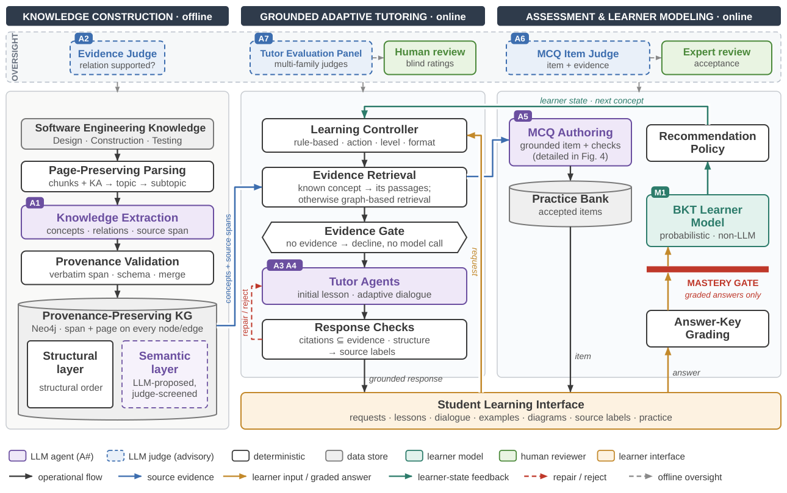

# GraphSE-Learn

**Design and Evaluation of an Evidence-Grounded Agentic GraphRAG System for Software Engineering Education**

**Bushra Salama Aljohani, Abdulaziz A. Alhubaishy, and Abdulmajeed Aljuhani**

Research overview accompanying the GraphSE-Learn manuscript.

GraphSE-Learn connects software engineering concepts to their source evidence, uses specialized agents to generate tutoring and assessment content, and assigns workflow control, grading, and mastery updates to deterministic components. The manuscript studies technical reliability; student learning outcomes remain a separate empirical question.

The architecture organizes software engineering knowledge across **Design, Construction, and Testing**, preserving the source passages behind concepts and relationships. This repository shares the research overview, the architecture diagram, and executable components for provenance validation, assessment grading, and learner modeling. The shared code uses synthetic data; the full research implementation and source corpus are not distributed here.

## Architecture



*GraphSE-Learn architecture overview.* The updated diagram connects offline knowledge construction, online grounded adaptive tutoring, and assessment with learner modeling. Advisory evaluation and human oversight are shown separately from operational control.

1. **Offline knowledge construction:** page-preserving parsing, concept and relation extraction (A1), deterministic provenance validation, canonicalization, and advisory evidence judging (A2). The graph distinguishes source-derived structural relations from model-proposed semantic relations. Each accepted semantic record retains its source evidence.
2. **Online grounded adaptive tutoring:** a deterministic Learning Controller resolves the request, selects evidence and bounded context, invokes the Initial Tutor (A3) or Adaptive Dialogue Tutor (A4), and checks response structure and citation references. A known concept resolves directly to its source passages; open queries can use concept matching, graph traversal, ranking, and provenance lookup.
3. **Online assessment and learner modeling:** the MCQ Author (A5) supplies questions when suitable stored items are unavailable. Stored answer keys determine grades. Only graded answers update the non-LLM BKT learner model (M1), which informs subsequent tutoring and recommendations.

### Components in the manuscript

| ID | Component | Role |
|---|---|---|
| A1 | Knowledge Extraction | Offline concept and relation generation. |
| A2 | Evidence Judge | Offline advisory evaluation of source support. |
| A3 | Initial Tutor | Initial evidence-grounded instruction. |
| A4 | Adaptive Dialogue Tutor | Follow-up instruction informed by learner context. |
| A5 | MCQ Author | Evidence-grounded assessment generation. |
| A6 | MCQ Item Judge | Advisory item evaluation in the ECD variant. |
| A7 | Tutor Evaluation Panel | Offline multi-family response evaluation. |
| M1 | BKT Learner Model | Non-LLM mastery estimation from graded answers. |

These components describe the research system; this repository does not distribute their full implementation.

## Grounded tutoring and controlled generation

The harness controls model inputs and checks structured outputs. Citation indices must refer to the supplied evidence; generated examples and other teaching assets remain distinguishable from source passages. Requests without usable evidence are declined without a model call. Invalid outputs receive bounded repair attempts and an explicit fallback if repair fails. Dialogue supplies instructional context but does not update mastery.

These checks establish structural compliance and traceability. They do not independently establish that a passage semantically supports every generated claim, a limitation examined directly in the manuscript.

## Assessment, adaptation, and mastery

The learner model applies standard Bayesian Knowledge Tracing after each graded answer, using pilot parameters `P(L0)=0.30`, `P(T)=0.30`, `P(G)=0.20`, and `P(S)=0.10`. The mastery threshold is **0.95**; the recommendation policy uses a separate attention cutoff of **0.60**. These are pilot settings, not estimates fitted to student data.

Unsure responses, dialogue, lesson views, and requests do not update mastery. Misconception signals guide instruction and recommendations without directly changing BKT. Source order supplies navigation rather than a validated prerequisite relation. Learners remain free to choose their next concept.

## Technical evaluation in the manuscript

The paper evaluates a single frozen system at three levels:

- **Requirements traceability:** architectural requirements mapped to their code or documentation basis and integration tests.
- **Component evaluation:** knowledge construction, retrieval comparisons, tutor evidence controls, MCQ generation, learner-model simulation, and agreement between automated and human judgments.
- **Integration validation:** controlled learner workflows, boundary cases, and fault injection across components.

The study distinguishes structural reliability from semantic grounding and technical performance from educational effectiveness. The shared components illustrate selected mechanisms; they do not reproduce the manuscript experiments.

## Repository contents

- `README.md`: research overview, authors, and architecture.
- `docs/figures/fig1-overview.png`: the updated architecture diagram.
- `example.py`: one standalone synthetic example of provenance checks, answer-key grading, and standard BKT.

The architecture diagram describes the complete research system, including components outside the shared code.

## Running the shared components

Python 3.10 or later; no dependencies, API keys, or network access required.

```bash
python example.py
```

The example checks a synthetic source ID, page range, and verbatim span; grades a static answer against a stored key; and updates mastery using standard BKT. A correct answer moves the pilot prior from `0.30` to approximately `0.760976`; an unsure response leaves mastery unchanged. Mastery is declared at `0.95`.

This is an educational illustration of three mechanisms, not a GraphRAG implementation or a reproduction of the study. It contains no tutoring prompts, model integrations, graph database, learner records, research datasets, deployment configuration, or experiment outputs.

## License

MIT License. Copyright (c) 2026 Bushra Salama Aljohani, Abdulaziz A. Alhubaishy, and Abdulmajeed Aljuhani.
